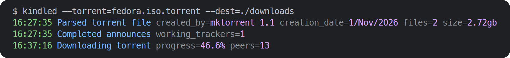

# Kindled 



A BitTorrent CLI client written in Go. Implements the BitTorrent protocol based on official BitTorrent Enhancement Proposals (BEPs).

Implemented BEPs:
* BEP-3:	[The BitTorrent Protocol Specification](https://www.bittorrent.org/beps/bep_0003.html)
* BEP-15: [UDP Tracker Protocol for BitTorrent](https://www.bittorrent.org/beps/bep_0015.html)
* BEP-20: [Peer ID Conventions](https://www.bittorrent.org/beps/bep_0020.html)
# Installation

## 1. Clone the repository
```bash
git clone https://github.com/dev-yeva/kindled && cd kindled
```

## 2. Copy the configuration file to the OS-specific directory
### Bash
```bash
CONFIG_DIR="${XDG_CONFIG_HOME:-$HOME/.config}/kindled"
mkdir -p "$CONFIG_DIR"
cp config/config.yaml "$CONFIG_DIR/config.yaml"
```

### PowerShell
```powershell
$configDir = Join-Path $env:APPDATA "kindled"
New-Item -ItemType Directory -Force -Path $configDir
Copy-Item "config\config.yaml" "$configDir\config.yaml"
```

### CMD
```cmd
set "CONFIG_DIR=%APPDATA%\kindled"
mkdir "%CONFIG_DIR%"
copy "config\config.yaml" "%CONFIG_DIR%\config.yaml"
```

## 3. Install the CLI 
```powershell
go install ./kindled
```

# Usage
```powershell
kindled --torrent=some.torrent --dest=./downloads
```


*Any metadata containing words like __Repack__ is purely coincidental.*